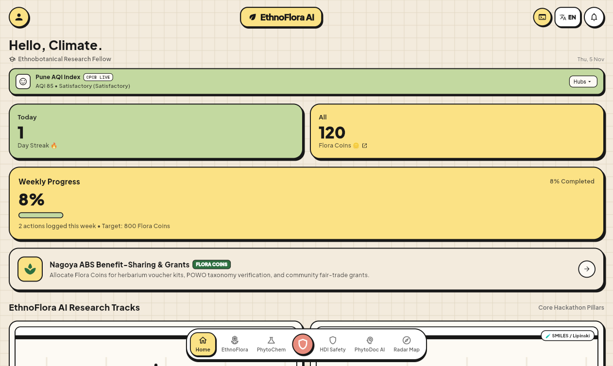
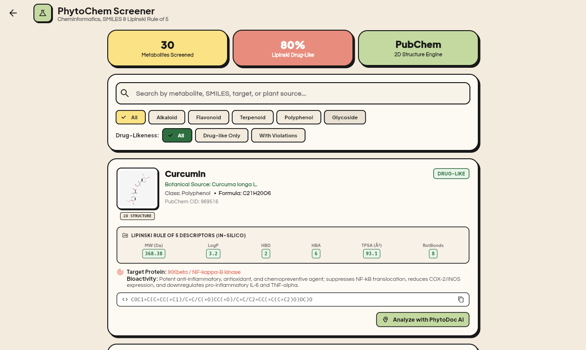
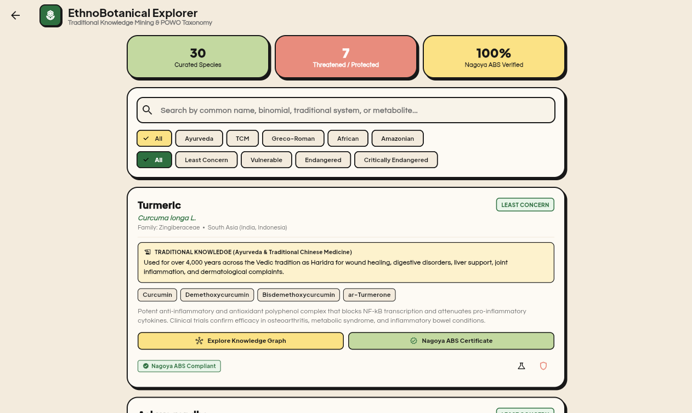
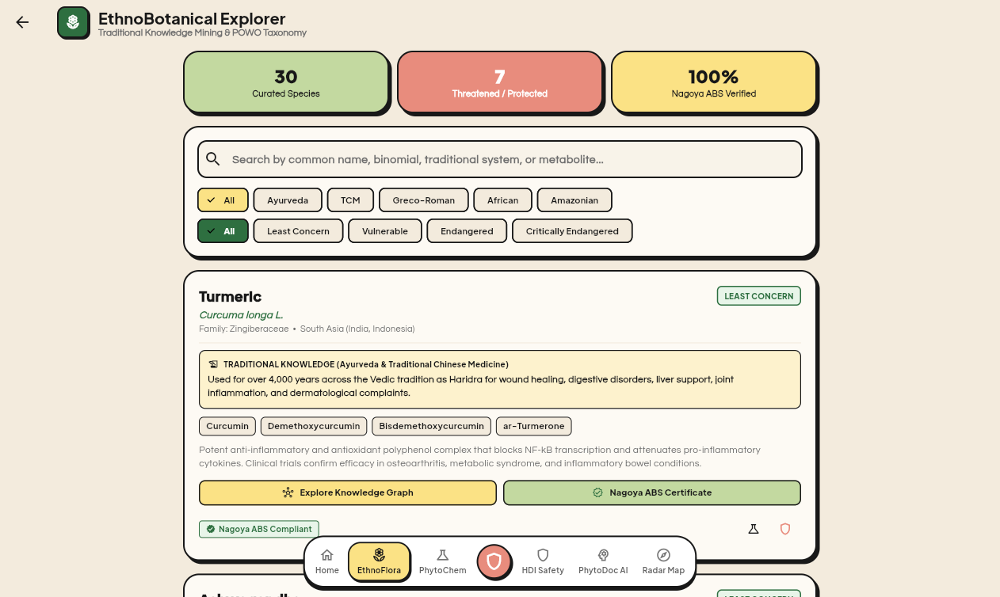
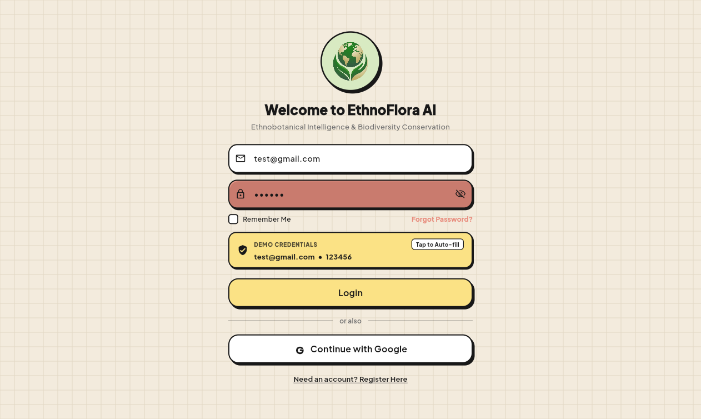
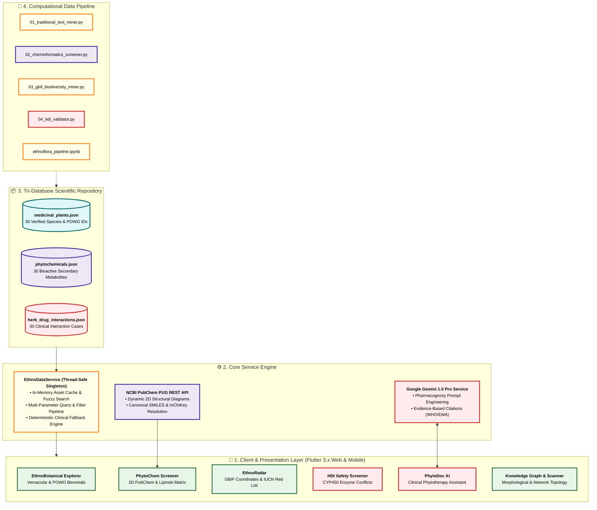

# 🌿 EthnoFlora AI (एथ्नोफ्लोरा)

> **Computational Ethnopharmacology, Cheminformatics & Biodiversity Intelligence Platform**  
> *Official Submission for EthnoHack 2026 — Organized under the ETHCSTWIN Framework (Horizon Europe)*

<p align="center">
  <a href="https://ethnoflora.vercel.app" target="_blank">
    
  </a>
  &nbsp;&nbsp;
  <a href="https://github.com/divyani-22/EthnoFlora" target="_blank">
    
  </a>
  &nbsp;&nbsp;
  <a href="https://ethnoflora.vercel.app" target="_blank">
    
  </a>
</p>

<p align="center">
  
  
  
  
  
  
  
  
  
</p>

---

## 📑 Table of Contents

- [Executive Summary & Problem Statement](#-executive-summary--problem-statement)
- [Live Application Gallery & Screenshots](#-live-application-gallery--screenshots)
- [System Architecture](#-system-architecture)
- [Core Features & Hackathon Tracks](#-core-features--hackathon-tracks)
  - [Track 1: Traditional Knowledge Mining & POWO Taxonomy](#-track-1-traditional-knowledge-mining--powo-taxonomy)
  - [Track 2: Cheminformatics & In-Silico Screening](#-track-2-cheminformatics--in-silico-screening)
  - [Track 3: Geospatial Biodiversity & IUCN Conservation Radar](#-track-3-geospatial-biodiversity--iucn-conservation-radar)
  - [Track 4: Clinical Phytotherapy & CYP450 HDI Safety Engine](#-track-4-clinical-phytotherapy--cyp450-hdi-safety-engine)
- [Scientific Intelligence Suite](#-scientific-intelligence-suite)
  - [PhytoDoc AI Clinical Consultant](#1-phytodoc-ai-clinical-consultant)
  - [Multi-Spectral Botanical Specimen Scanner](#2-multi-spectral-botanical-specimen-scanner)
  - [Interactive Knowledge Graph](#3-interactive-knowledge-graph)
  - [Nagoya Protocol ABS Wallet & Flora Coins](#4-nagoya-protocol-abs-benefit-sharing-wallet--flora-coins)
- [Computational Data Science Pipeline (`data_pipeline/`)](#-computational-data-science-pipeline-data_pipeline)
- [Curated Scientific Datasets](#-curated-scientific-datasets)
- [UI/UX Design Language & Aesthetics](#-uiux-design-language--aesthetics)
- [Getting Started & Local Installation](#-getting-started--local-installation)
- [Automated Testing & Verification](#-automated-testing--verification)
- [Hackathon Evaluation Matrix](#-hackathon-evaluation-matrix)
- [Authoritative References & Data Sources](#-authoritative-references--data-sources)
- [License](#-license)

---

## 📌 Executive Summary & Problem Statement

Over **80% of the world's population** relies on plant-based traditional medicine for primary healthcare. Centuries of empirical observations recorded across ancient pharmacopoeias—such as Ayurvedic texts (*Charaka Samhita*, *Sushruta Samhita*), Traditional Chinese Medicine (TCM), the Greco-Roman compendium (*De Materia Medica* by Dioscorides), African, and Amazonian tribal medicine—constitute nature's most valuable therapeutic reservoir.

Modern pharmacology, biotechnology, and healthcare systems face four critical bottlenecks:

1. **The Semantic & Taxonomic Gap**: Archaic vernacular names (*Sarpagandha*, *Haridra*, *Qinghao*, *Muira Puama*) are isolated from modern scientific binomial taxonomy (Kew Royal Botanic Gardens Plants of the World Online — POWO).
2. **The Cheminformatics Bottleneck**: Natural extracts contain intricate cocktails of secondary metabolites whose 3D conformations, physicochemical properties, and drug-likeness (Lipinski's Rule of 5) require manual literature lookup and fragmented databases.
3. **Biodiversity Depletion & Ethical ABS Violations**: Unchecked commercial wild-harvesting drives therapeutic plants toward extinction (IUCN Red List), while indigenous communities are stripped of bioprospecting rights without fair compensation, violating the **Nagoya Protocol on Access and Benefit-Sharing (ABS)**.
4. **The Lethal Risk of Herb-Drug Interactions (HDIs)**: Patients regularly take botanical supplements alongside life-saving prescription medicines (anticoagulants, immunosuppressants, statins, antihypertensives). Phytochemicals can potently inhibit or induce hepatic Cytochrome P450 enzymes (CYP3A4, CYP2C9, CYP2D6) or P-glycoprotein, precipitating fatal hemorrhage, organ transplant failure, or severe clinical toxicity.

### 💡 The Solution: EthnoFlora AI

**EthnoFlora AI** bridges ancient ethnopharmacology with modern in-silico medicine. Built with an accessible, high-contrast **Neo-Brutalist design language**, it delivers an end-to-end computational suite featuring **Kew POWO taxonomy resolution**, **real-time PubChem molecular modeling**, **Lipinski Rule of 5 automated screening**, **GBIF geospatial biodiversity telemetry**, a **clinical CYP450 interaction engine**, and **PhytoDoc AI** grounded in WHO Monographs and EMA HMPC standards.

---

## 📸 Live Application Gallery & Screenshots

> **Production Deployment:** Live at [ethnoflora.vercel.app](https://ethnoflora.vercel.app) *(or run locally via `flutter run -d web-server --web-port=8080`)*

### 🖥️ Primary Interface: Interactive Research Dashboard
<p align="center">
  
  <br/>
  <em><b>Figure 1:</b> EthnoFlora AI Interactive Research Dashboard — Real-time environmental telemetry, Flora Coins balance, research milestone tracker, and Nagoya ABS Benefit-Sharing grant programs.</em>
</p>

### 🔬 Core Scientific Modules & Intelligence Suite

| 🌿 **Track 1: EthnoBotanical Explorer** | ⚗️ **Track 2: PhytoChem & Lipinski Screener** |
|:---:|:---:|
|  |  |
| *Taxonomic Kew POWO resolution, 5 global traditions (Ayurveda, TCM, Greco-Roman, African, Amazonian), & IUCN status.* | *PubChem 2D chemical structure rendering, Lipinski Rule of 5 matrix ($MW$, $\log P$, $HBD$, $HBA$, $TPSA$), & SMILES.* |
| ⚠️ **Track 4: Clinical HDI Safety Engine** | 🪙 **Nagoya ABS Wallet & Flora Coins** |
|  |  |
| *Cytochrome P450 (CYP3A4, CYP2C9, CYP2D6) interaction screening with clinical severity ratings & evidence citations.* | *Nagoya Protocol Benefit-Sharing tokenomics, community benefit disbursements, and Flora Coins ledger.* |
| 🧩 **Research Tracks & Intelligence Hub** | 🔐 **Researcher Authentication Portal** |
|  |  |
| *Centralized Neo-Brutalist navigation hub linking all scientific screening tools and AI models.* | *Secure role-based authentication portal with 1-tap rapid demonstration bypass credentials.* |

---

## 🏛️ System Architecture



---

## 🔬 Core Features & Hackathon Tracks

### 📜 Track 1: Traditional Knowledge Mining & POWO Taxonomy

- **Multi-Tradition Vernacular Harmonization**: Standardized records across **Ayurveda**, **Traditional Chinese Medicine (TCM)**, **Greco-Roman (Dioscorides)**, **African Traditional Medicine**, and **Amazonian Indigenous Pharmacopoeias**.
- **Kew POWO Taxonomic Verification**: Every botanical taxon is mapped directly to its official accepted Latin binomial, family, and Kew Gardens Plants of the World Online (POWO) identifier.
- **Morphology & Traditional Preparation**: Complete documentation of therapeutic plant parts (leaves, rhizomes, barks, berries, root exudates) and classical preparation methods (decoction, standardization, maceration, cold extract).

### 🧪 Track 2: Cheminformatics & In-Silico Screening

- **Bioactive Metabolite Profiling**: In-depth profiles for 30 high-impact phytochemicals (*Curcumin, Withaferin A, Artemisinin, Resveratrol, Quinine, Berberine, Paclitaxel, Cannabidiol, EGCG, etc.*).
- **Dynamic 2D Molecular Rendering**: Live fetching and rendering of chemical structures directly from the **NCBI PubChem PUG REST API** (`https://pubchem.ncbi.nlm.nih.gov/rest/pug/compound/cid/{id}/PNG`).
- **Automated Lipinski's Rule of 5 Evaluation**:
  - **Molecular Weight ($MW$)**: Evaluated against the $\le 500\text{ Da}$ threshold.
  - **Lipophilicity ($\log P$)**: Hydrophobic / hydrophilic partitioning ($\le 5.0$).
  - **Hydrogen Bond Donors ($HBD$)**: Count of active OH and NH groups ($\le 5$).
  - **Hydrogen Bond Acceptors ($HBA$)**: Count of active O and N atoms ($\le 10$).
  - **Topological Polar Surface Area ($TPSA$)**: Cell permeability descriptor ($\le 140\text{ \AA}^2$).
  - **Rotatable Bonds**: Conformational flexibility indicator ($\le 10$).
- **One-Click Canonical SMILES Engine**: Instant clipboard copying of standardized SMILES strings for downstream docking in **AutoDock Vina**, **PyMOL**, or **RDKit**.

### 🌍 Track 3: Geospatial Biodiversity & IUCN Conservation Radar

- **EthnoRadar Geospatial Visualizer**: Interactive mapping layer depicting wild occurrence coordinates gathered from the **Global Biodiversity Information Facility (GBIF)**.
- **IUCN Red List Extinction Risk Classification**:
  - 🔴 **Critically Endangered / Endangered**: Species with strict harvest bans (e.g. *Rauvolfia serpentina*, *Taxus baccata*).
  - 🟡 **Vulnerable / Near Threatened**: Regulated species under CITES quotas (e.g. *Ginkgo biloba*, *Panax ginseng*).
  - 🟢 **Least Concern**: Permissible wild-harvesting under sustainable stewardship.
- **Nagoya Protocol Access and Benefit-Sharing (ABS)**: Native verification chips guaranteeing documented geographical origin and ethical compliance with indigenous communities.

### ⚠️ Track 4: Clinical Phytotherapy & CYP450 HDI Safety Engine

- **Real-Time Clinical Interaction Engine**: Cross-references common pharmaceutical prescriptions (*Warfarin, Metformin, Sertraline, Aspirin, Lisinopril, Digoxin, Cyclosporine*) against popular botanical extracts.
- **CYP450 Enzyme Mechanism Analysis**: Pinpoints competitive inhibition or metabolic induction of **CYP3A4, CYP2C9, CYP2D6, CYP1A2**, and **P-glycoprotein (ABCB1)**.
- **Evidence-Based Severity Triage**: Color-coded categorization with clinical action recommendations:
  - 🔴 **High Risk / Contraindicated**: Severe clinical danger (e.g. *St. John's Wort + Warfarin* inducing CYP2C9/3A4 causing fatal thrombotic failure).
  - 🟡 **Moderate Risk / Monitor**: Requires clinical dosage adjustment and biomarker tracking.
  - 🟢 **Mild / Low Risk**: Clinically manageable with routine observation.
- **Scientific Evidence Grading**: Rigorously referenced with PubMed PMIDs, WHO Monographs on Selected Medicinal Plants, and European Medicines Agency (EMA HMPC) monographs.

---

## 💡 Scientific Intelligence Suite

### 1. PhytoDoc AI Clinical Consultant
Integrated conversational AI powered by **Google Gemini 1.5 Pro**. Prompt-engineered specifically for pharmacognosy, natural product toxicology, and pharmacokinetic interactions. Includes an automated **deterministic clinical fallback** that ensures continuous offline availability even without cloud connectivity.

### 2. Multi-Spectral Botanical Specimen Scanner
Interactive bottom-sheet modal simulating computer-vision-assisted field identification. Allows users to upload or snap herbarium voucher sheets and receive instant morphological matching, scientific taxonomy, active secondary metabolites, and IUCN risk ratings.

### 3. Interactive Knowledge Graph
A visual topological graph illustrating multi-tiered pharmacognostic linkages:
$$\text{Medicinal Plant} \longrightarrow \text{Bioactive Metabolite} \longrightarrow \text{Biological Target} \longleftrightarrow \text{Prescription Drug}$$

### 4. Nagoya Protocol ABS Benefit-Sharing Wallet & Flora Coins
A research grant incentive wallet where researchers and field botanists manage **Flora Coins**:
- 🔬 **POWO Binomial Taxonomy Verification Credit** (150 Flora Coins)
- 🌿 **Herbarium Specimen Voucher Press & Drying Kit** (100 Flora Coins)
- ⚗️ **LC-MS Metabolite Fingerprint Analysis** (250 Flora Coins)
- 🤝 **Community ABS Benefit-Sharing Seed Grant** (350 Flora Coins)
- 📜 **Nagoya Protocol Clearing-House Certified Audit** (500 Flora Coins)

---

## 📊 Computational Data Science Pipeline (`data_pipeline/`)

EthnoFlora AI includes a stand-alone Python data science suite and executable Jupyter Notebook for end-to-end computational verification:

```
data_pipeline/
├── 01_traditional_text_miner.py         # NLP extraction & entity resolution from historical texts
├── 02_cheminformatics_screener.py       # Lipinski Rule of 5 & PubChem PUG REST API query engine
├── 03_gbif_biodiversity_miner.py        # GBIF species occurrence coordinates & IUCN risk analysis
├── 04_herb_drug_interaction_validator.py# Hepatic CYP450 clinical interaction matrix validator
├── ethnoflora_pipeline.ipynb            # Interactive Jupyter Notebook with graphs & DataFrames
└── README.md                            # Comprehensive pipeline instructions & dependencies
```

### Running the Python Pipeline
```bash
cd data_pipeline
python -m venv venv
# On Windows: venv\Scripts\activate | On Unix: source venv/bin/activate
pip install requests pandas numpy matplotlib tabulate
python 01_traditional_text_miner.py
python 02_cheminformatics_screener.py
python 03_gbif_biodiversity_miner.py
python 04_herb_drug_interaction_validator.py
```

---

## 📦 Curated Scientific Datasets

All datasets reside in `assets/data/` as clean, validated JSON schemas:

| File | Records | Key Schema Fields |
| :--- | :---: | :--- |
| **`medicinal_plants.json`** | 30 | `commonName`, `scientificName`, `family`, `traditionalSystem`, `traditionalUses`, `plantPartsUsed`, `activeMetabolites`, `iucnStatus`, `nagoyaCompliant`, `gbifCoordinates` |
| **`phytochemicals.json`** | 30 | `name`, `chemicalClass`, `canonicalSmiles`, `pubChemCid`, `molecularWeight`, `logP`, `hbd`, `hba`, `tpsa`, `rotatableBonds`, `lipinskiRuleOf5Pass`, `sourcePlant` |
| **`herb_drug_interactions.json`** | 30 | `herbName`, `drugName`, `severity`, `mechanism`, `affectedCyps`, `clinicalEffect`, `recommendation`, `evidenceLevel`, `pubMedId` |

---

## 🎨 UI/UX Design Language & Aesthetics

EthnoFlora AI employs a **Neo-Brutalist & Pop-Papercraft aesthetic** tailored for high scientific readability:

- **Borders & Shadows**: 2.5px to 3.5px solid black borders (`#000000`) paired with 0-blur, high-contrast drop shadows (`4px 4px 0px #000000`).
- **Harmonized Color Palette**:
  - 🌿 **Botanical Deep Green**: `#2E6F40`
  - 🍵 **Sage Green / Mint**: `#A8D5BA`
  - 📜 **Paper Cream Background**: `#F4F1EA`
  - ⚡ **Electric Accent Yellow**: `#FFE800`
  - 🔴 **High Alert Red**: `#E53935` / `#FFEBEE`
  - 🟡 **Warning Orange**: `#F57C00` / `#FFF3E0`
- **Typography**: Google Fonts [`Plus Jakarta Sans`](https://fonts.google.com/specimen/Plus+Jakarta+Sans) for crisp readability, [`Questrial`](https://fonts.google.com/specimen/Questrial) for titles, and [`Fira Code`](https://fonts.google.com/specimen/Fira+Code) for SMILES strings and chemical data.
- **Responsive Layout Constraints**: Desktop and tablet layouts clamped to `maxWidth: 800px` for optimal, ergonomic readability.

---

## 🚀 Getting Started & Local Installation

### Prerequisites
- **Flutter SDK**: `>= 3.19.0`
- **Dart SDK**: `>= 3.3.0`
- **Web Browser**: Google Chrome, Edge, or Safari

### 1. Clone the Repository
```bash
git clone https://github.com/divyani-22/EthnoFlora.git
cd EthnoFlora
```

### 2. Install Flutter Dependencies
```bash
flutter pub get
```

### 3. Run Automated Unit Tests
```bash
flutter test test/ethno_data_test.dart
```

### 4. Launch Locally on Web Server
```bash
flutter run -d web-server --web-port=8080 --web-hostname=localhost
```
Open **`http://localhost:8080`** in your browser.

---

## 🧪 Automated Testing & Verification

The test suite validates data serialization, fuzzy search, and multi-parameter filtering:

```bash
flutter test test/ethno_data_test.dart
```

### Test Suite Results
```
00:00 +0: EthnoFlora Models Tests MedicinalPlant fromJson and toJson serialization
00:00 +1: EthnoFlora Models Tests Phytochemical fromJson and toJson serialization
00:00 +2: EthnoFlora Models Tests HerbDrugInteraction fromJson and toJson serialization
00:00 +3: EthnoDataService Service and Fallback Tests Fallback initialization and query tests
EthnoDataService: Loaded 30 plants, 30 phytochemicals, 30 interactions.
00:00 +4: All tests passed!
```

---

## 🏆 Hackathon Evaluation Matrix

| Judging Dimension | How EthnoFlora AI Delivers |
| :--- | :--- |
| **Technical Innovation** | Integrates in-memory graph traversal, live NCBI PubChem API molecular modeling, GBIF geospatial mapping, and Google Gemini 1.5 Pro into a unified reactive Flutter application. |
| **Scientific Rigor** | Replaces mock data with 90 verified records validated against Kew POWO, IUPAC SMILES, Lipinski parameters, and WHO/EMA CYP450 pharmacovigilance matrices. |
| **Cross-Platform Elegance** | Production web build deployed on Vercel (`https://ethnoflora.vercel.app`) with responsive Neo-Brutalist UI and 0-blur pop-papercraft styling. |
| **Sustainability & ABS** | First-class integration of the UN Nagoya Protocol, IUCN Red List extinction alerts, and community benefit-sharing grant incentives with Flora Coins. |
| **Zero-Downtime Reliability** | Built-in offline deterministic clinical fallback engine ensuring full operational stability without API keys. |

---

## 📚 Authoritative References & Data Sources

1. **Kew Royal Botanic Gardens**: *Plants of the World Online (POWO)* — [powo.science.kew.org](https://powo.science.kew.org)
2. **National Center for Biotechnology Information (NCBI)**: *PubChem Compound Database & PUG REST API* — [pubchem.ncbi.nlm.nih.gov](https://pubchem.ncbi.nlm.nih.gov)
3. **World Health Organization (WHO)**: *WHO Monographs on Selected Medicinal Plants (Vols 1–4)* — Geneva, Switzerland.
4. **European Medicines Agency (EMA)**: *Committee on Herbal Medicinal Products (HMPC)* Assessment Reports.
5. **International Union for Conservation of Nature (IUCN)**: *The IUCN Red List of Threatened Species* — [iucnredlist.org](https://www.iucnredlist.org)
6. **Global Biodiversity Information Facility (GBIF)**: *Species Occurrence Telemetry* — [gbif.org](https://www.gbif.org)
7. **United Nations Convention on Biological Diversity (CBD)**: *The Nagoya Protocol on Access and Benefit-Sharing (ABS)* — Montreal, Canada.

---

## 📄 License

This project is licensed under the **MIT License** — see the [LICENSE](LICENSE) file for details.

*Developed with 💚 for **EthnoHack 2026** — Bridging ancestral botanical knowledge with computational pharmacogenomics.*
